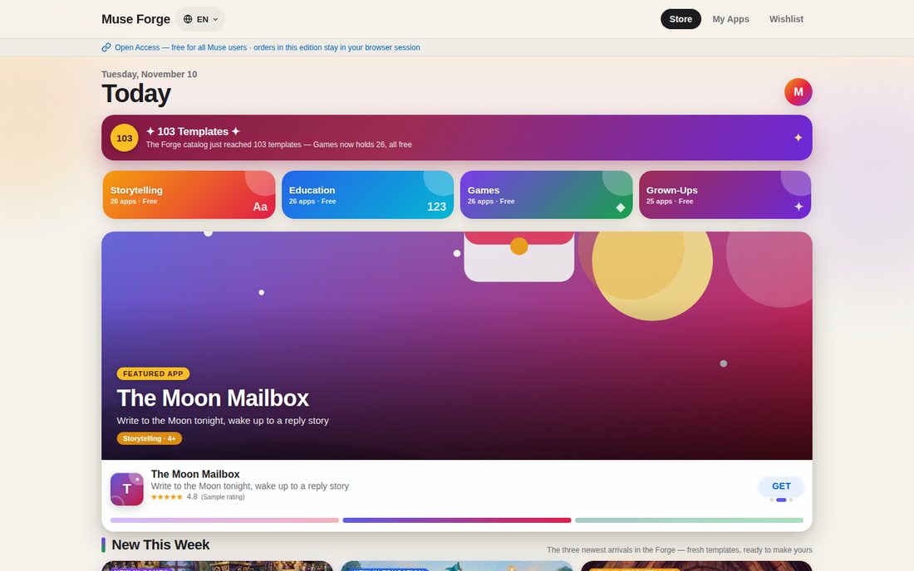
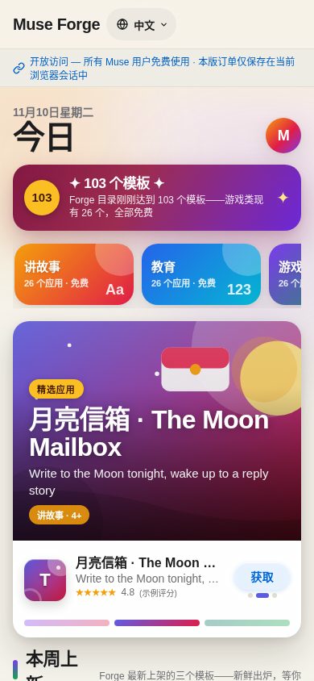

# Forge — Unofficial App Templates for Muse

**Unofficial personal project. Not affiliated with, endorsed, or sponsored by Meta. "Muse" is a trademark of Meta; this project only describes templates that can be built with Muse.**

**All templates are free. No payment is taken anywhere; "Get" simply means: take the spec and have your Muse build it.**

Content note: These templates were created with AI assistance (Muse) and edited/arranged by the maintainer.

## Demo — what the storefront looks like

The templates come from a working storefront app built with Muse. Screenshots of that demo edition (it shows the full catalog, including a few templates that are intentionally not distributed in this repo):





*Left/top: desktop storefront (English). Right/bottom: the same storefront on mobile with the one-tap 中文 toggle. The demo is view-only — to actually get an app, use a template spec below.*

## What this is — and what it is not

This repository is a catalog of **build specs**: one Markdown file per template describing what the app is, its features, the questions to ask before building it, and sample content. There are 94 templates.

What it is NOT:

- It is **not an installable app**, and there is no import button. Downloading this repo does not install anything.
- It is not a store: nothing is sold, no accounts, no checkout.
- It is not an official Meta or Muse product (see the note at the top).

Each template becomes a real app only when a Muse builds it fresh, in the user's own Muse Library, from the spec.

## How to use with your Muse

Copy this prompt into your Muse chat, together with the template file (see below):

```
Build me my own app from a Forge template. The spec is in the file I am attaching: [template file]. First ask me the questions in its Customization questions section one at a time and use my answers; then let me describe extra changes in my own words; then build it as a new Space in my Library. Build it static unless the spec says it needs stored data. Do not copy any personal data from the spec — where the spec has placeholders, use my details.
```

### Getting a template into your chat

1. Find the template you want in `templates/` (or in `catalog.json`).
2. Attach the `.md` file to your Muse chat, or paste its contents into the chat.
3. Paste the prompt above. Your Muse will ask the customization questions, then build your own copy as a new Space in your Library.

Expect a fresh build inspired by the spec, not a pixel-perfect copy: layout, illustrations and wording will be your Muse's own, and your app starts empty.

## Catalog

94 templates in total: 24 Storytelling, 21 Education, 25 Games, 24 Grown-ups.

### Storytelling (24)

- [Cloud Shepherd Stories](templates/cloud-shepherd-stories.md) — Gentle sky stories, herded home one cloud at a time
- [Firefly Postcard Stories](templates/firefly-postcard-stories.md) — Tiny stories mailed from a summer night
- [Pillow Fort Chronicles](templates/pillow-fort-chronicles.md) — Cozy blanket-fort tales your child helps steer
- [Story Dice Studio](templates/story-dice-studio.md) — Roll a hero, a place, and a problem — then tell a story that's never existed before.
- [Story Lighthouse](templates/story-lighthouse.md) — A calm harbour-light keeper who turns each night into a story
- [Suitcase Stories](templates/suitcase-stories.md) — Open the suitcase, pick a souvenir, hear a tale from a far-away place.
- [The Acorn Archive](templates/acorn-archive-tales.md) — Bedtime tales tucked inside acorns, opened one at a time
- [The Attic Telescope Tales](templates/attic-telescope-tales.md) — A new star each night, a gentle tale to match
- [The Button Jar Tales](templates/button-jar-tales.md) — Shake the jar, pick a button, tell a tiny tale together
- [The Harbor Light Story Boat](templates/harbor-light-story-boat.md) — A floating library that sails one gentle story at a time
- [The Kite Tail Tales](templates/kite-tail-tales.md) — Cozy sky stories tied one ribbon at a time
- [The Lantern Story Club](templates/lantern-story-club.md) — Stories that glow, one lantern at a time
- [The Marigold Door Tales](templates/marigold-door-tales.md) — A tiny garden door to a new co-created world each evening
- [The Midnight Bakery](templates/midnight-bakery-tales.md) — A warm bake-along story that rises one choice at a time
- [The Moon Mailbox](templates/moon-mailbox.md) — Write to the Moon tonight. Wake up to a story that answers you.
- [The Museum of Small Hours](templates/museum-of-small-hours.md) — Tiny nighttime exhibits that each tell one gentle story
- [The Night Market of Tiny Lights](templates/night-market-tiny-lights.md) — Wander lantern-lit stalls and co-create a tale at each one
- [The Night Train Story Atlas](templates/night-train-story-atlas.md) — A cozy station-by-station story journey
- [The Paper Boat Post Office](templates/paper-boat-post-office.md) — River letters that carry a story downstream, one stop at a time
- [The Riverstone Story Circle](templates/riverstone-story-circle.md) — Stories told one smooth stone at a time
- [The Seed Library](templates/seed-library-stories.md) — Tiny seed packets that grow into gentle stories
- [The Story Quilt](templates/story-quilt-workshop.md) — Stitch a story together, one patch at a time
- [The Tidepool Story Keeper](templates/tidepool-story-keeper.md) — Tiny sea stories that grow one gentle chapter at a time
- [The Umbrella Library](templates/umbrella-library-stories.md) — Borrow an umbrella, hear the story it carried through the rain

### Education (21)

- [Curious Minds: Science Lab](templates/curious-minds-science-lab.md) — Ask, predict, test, and explain — real science thinking for young kids.
- [Fraction Kitchen Studio](templates/fraction-kitchen-studio.md) — Learn fractions by measuring, mixing and sharing
- [Paragraph Pioneers](templates/paragraph-pioneers.md) — Build clear paragraphs — topic sentence, details, and a strong finish
- [Pattern Builders: Logic & Early Coding](templates/pattern-builders.md) — Sequences, loops, and debugging — coding thinking with no code to type.
- [Simple Machines Workshop](templates/simple-machines-workshop.md) — Hands-on levers, pulleys and ramps kids build and test
- [The Clock & Compass Workshop](templates/clock-compass-workshop.md) — Hands-on time, calendars and directions — learned by doing
- [The Constellation Classroom](templates/constellation-classroom.md) — Find Polaris, track the Moon, and read the night sky
- [The Estimation Station](templates/estimation-station.md) — Learn to guess smart — round, estimate, and check if an answer makes sense
- [The Hundred Chart Workshop](templates/hundred-chart-workshop.md) — Find the pattern hiding in the hundred chart
- [The Map Room: Geography Detectives](templates/map-room-geography-detectives.md) — Read maps, follow routes, and think like a cartographer
- [The Measurement Workshop](templates/measurement-workshop.md) — Estimate, measure, and prove it — with rulers, scales and timers
- [The Number Line Ferry](templates/number-line-ferry.md) — Ride the ferry, hop the number line, land exactly on target
- [The Place Value Post Office](templates/place-value-post-office.md) — Sort parcels by hundreds, tens and ones
- [The Sentence Workshop](templates/sentence-workshop.md) — Build silly, strong sentences — grammar you can play with
- [The Shadow Light Lab](templates/shadow-light-lab.md) — Hands-on light, shadow and measuring experiments for curious kids
- [The Symmetry Studio](templates/symmetry-studio.md) — Fold, flip and finish the other half
- [The Tally & Chart Workshop](templates/tally-chart-workshop.md) — Turn tallies into charts — and charts into answers
- [The Weather Window](templates/weather-window-lab.md) — Look up, log the sky, and learn to predict tomorrow
- [The Word Roots Garden](templates/word-roots-garden.md) — Grow big words from small roots — prefixes, roots and suffixes made visible
- [Word Lab: Vocabulary & Reading Quest](templates/word-lab.md) — Learn powerful words in real stories — then use them like a writer.
- [Young Naturalist Field Journal](templates/young-naturalist-field-journal.md) — Observe, sketch and wonder — one habitat at a time

### Games (25)

- [Bee Trail Builders](templates/bee-trail-builders.md) — A cooperative trail-planning board game from hive to flowers
- [Cipher Island](templates/cipher-island.md) — Crack gentle codes, unlock the island, one clue at a time
- [Classroom Feelings Detective](templates/feelings-detective.md) — Read the clues, guess what a classmate is feeling
- [Compass Rose Quest](templates/compass-rose-quest.md) — Navigate by clues, not by guessing — a map-logic adventure
- [Creature Quest: Kindness Card Puzzles](templates/creature-quest-kindness-cards.md) — Combine creature cards, solve the puzzle guardians, win with clever kindness.
- [Echo Grove](templates/echo-grove-memory.md) — A listening memory game — hear the sequence, play it back
- [Gear Train Workshop](templates/gear-train-workshop.md) — Predict, build and test spinning gear trains
- [Lantern Logic: Truth-Tellers & Tricksters](templates/lantern-logic.md) — Gentle logic puzzles where you deduce who is telling the truth
- [Lily Pad Stack](templates/lily-pad-stack.md) — Move the whole tower, one leaf at a time
- [Marble Run Architects](templates/marble-run-architects.md) — Design the track, test gravity, land every marble home
- [Pebble Path Tactics](templates/pebble-path-tactics.md) — Plan every step, then watch your hedgehog trot home
- [Prism Code Breakers](templates/prism-code-breakers.md) — Crack the colour code with pure deduction
- [Puzzle Manor: Cozy Escape Rooms](templates/puzzle-manor-cozy-escape.md) — Solve chained clues, unlock cozy rooms, escape by thinking — not rushing.
- [Rhythm Relay Lab](templates/rhythm-relay-lab.md) — Listen, remember, and play the beat back together
- [The Balance Beam Bakery](templates/balance-beam-bakery.md) — A cooperative balance-scale puzzle game — weigh, swap, and make both sides equal
- [The Chime Tower Code](templates/chime-tower-code.md) — A bell-and-lantern logic game where every clue counts
- [The Clockwork Caravan](templates/clockwork-caravan.md) — A cooperative route-and-order puzzle adventure
- [The Domino Design Lab](templates/domino-design-lab.md) — Build a chain, predict the fall, then watch it run
- [The Ferryman's Manifest](templates/ferryman-manifest.md) — A one-item-at-a-time river-crossing logic game
- [The Gadget Sorting Machine](templates/gadget-sorting-machine.md) — Sort inventions with AND, OR and NOT — checked rules, no wrong answers
- [The Gem Hoard Game](templates/gem-hoard-game.md) — A take-turns gem game where counting is the strategy
- [The Mirror Garden Maze](templates/mirror-garden-maze.md) — Bounce sunlight to the flowers with clever mirrors
- [The Mislabelled Museum](templates/mislabelled-museum.md) — A cozy deduction game: read the clues, place every exhibit
- [The Tidal Clock Tower](templates/tidal-clock-tower.md) — A cooperative clue game about order, bells and tide steps
- [Treasure Tide: Map Adventure](templates/treasure-tide-map-adventure.md) — Plan the route, ride the tides, find the treasure — together.

### Grown-ups (24)

- [Chapter & Verse Book Club](templates/chapter-verse-book-club.md) — A warm book-club companion that writes the discussion for you
- [Clue & Supper](templates/clue-and-supper.md) — Host a murder-free mystery night: assign secret roles, serve the courses, and let your guests solve it between starter and dessert.
- [Pocket Bookbinding Atelier](templates/pocket-bookbinding-atelier.md) — Bind a small notebook by hand, one quiet signature at a time
- [Poetry Forms Studio](templates/poetry-forms-studio.md) — Learn a classic form, draft it line by line, revise with care
- [Porch Garden Notebook](templates/porch-garden-notebook.md) — A calm seasonal notebook for a small green corner
- [Second Thoughts](templates/second-thoughts.md) — A weekly club in an app: one fair debate, one fiendish logic puzzle, and the tools to change your mind well.
- [Table Talk Studio](templates/table-talk-studio.md) — Great questions, easy hosting — a conversation night that flows
- [The Analog Photo Walk](templates/analog-photo-walk.md) — Slow walks, 12 frames, and a contact sheet you keep
- [The Commonplace Book](templates/commonplace-book.md) — Keep what you read. Connect what you think. Review what matters.
- [The Evening Sketchbook Salon](templates/evening-sketchbook-salon.md) — A calm 20-minute drawing ritual for grown-ups — no talent required
- [The Heirloom Recipe Atelier](templates/heirloom-recipe-atelier.md) — Turn a beloved dish into a keepsake recipe story
- [The Keepsake Interview Studio](templates/keepsake-interview-studio.md) — Gentle interviews that turn conversations into keepsakes
- [The Letterpress Workshop](templates/letterpress-workshop.md) — Set type by hand, ink it, and pull your first print
- [The Listening Room](templates/listening-room.md) — Music evenings that turn listening into conversation
- [The Mend & Make Studio](templates/mend-and-make-studio.md) — Turn worn favourites into kept stories — one visible repair at a time
- [The Morning Pages Studio](templates/morning-pages-studio.md) — Begin the day with three honest pages — no audience, no editing, just clarity
- [The Night Sky Salon](templates/night-sky-salon.md) — An unhurried evening of moon, planets and good conversation
- [The Slow Stitch Sampler](templates/slow-stitch-sampler.md) — Stitch a sampler one quiet row at a time
- [The Soundwalk Diary](templates/soundwalk-diary.md) — Slow walks that teach you to listen to a place
- [The Sourdough Starter Diary](templates/sourdough-starter-diary.md) — A calm kitchen journal for feeding, timing and trusting your starter
- [The Spice Blend Atelier](templates/spice-blend-atelier.md) — Blend a small-batch spice mix by weight, taste, and note
- [The Tea Tasting Journal](templates/tea-tasting-journal.md) — A slow tasting notebook for leaves, steam and quiet notes
- [The Unfinished Letter Studio](templates/unfinished-letter-studio.md) — Finish the letter you have been meaning to write
- [Weekend Reset Studio](templates/weekend-reset-studio.md) — A calm 25-minute reset for a home that breathes again

## Notes for parents (kids' templates)

These are templates for adults/parents to build for their families. By default the templates do not collect children's personal information; if you adapt one into a hosted service that collects names, voice, photos or other personal data from children under 13, privacy law (e.g. COPPA in the US) may apply — get parental consent first.

Some templates from the maintainer's private collection are intentionally not included in this repository.

## License

See [LICENSE](LICENSE) for the license and [NOTICE](NOTICE) for notes on AI-generated portions and third-party marks.
